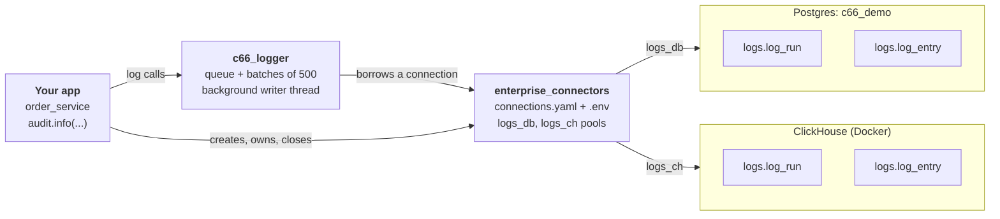

# c66_logger Demo Guide: From Database Setup to Logged Rows

## What the demo shows

In about 20 minutes, an app logs the same run, with one entry at every log level, to Postgres and to ClickHouse through c66-data-connection-layer. We then query the rows back from `logs.log_run` and `logs.log_entry` in both databases. Last, c66-chatbot's existing telemetry calls write to the same tables, unchanged.

The demo makes five points:

- **The app owns the connections.** c66-data-connection-layer (`enterprise_connectors`) loads them from `connections.yaml` and `.env`, and holds the logins and pools. c66_logger never sees a password and never closes a connector.
- **Borrow and return.** Each write borrows a pooled connection with `connector.connection()` and hands it back. The pools show 0 in use after logging.
- **One API, two targets.** The same logging code writes to Postgres or ClickHouse; only `target_type` and the connection name change. The tables have the same columns in both.
- **Multi-tenant by design.** Every row carries `tenant_id` and `environment_id`. In Postgres, foreign keys tie them to `app.tenant` and `app.tenant_environment`.
- **Runs group events.** A run is one row in `logs.log_run` (status, duration, metadata). Each event in it is a row in `logs.log_entry` linked by `run_id`.



The app loads its connections once and hands a connector to c66_logger. Each write borrows a pooled connection, writes, and returns it.

## Prerequisites

Check these before the meeting.

| Item | Version used | Check with |
| --- | --- | --- |
| Python | 3.12.5 | `python3 --version` |
| Postgres server + `psql` | 18.3 (Homebrew), on `localhost:5432` | `psql --version` |
| Docker (for ClickHouse) | 28.4.0 | `docker info --format '{{.ServerVersion}}'` |
| ClickHouse server image | `clickhouse/clickhouse-server:25.8` | Pulled in Step 1b |
| c66_logger checkout | 0.4.2 | `~/dataproducts/c66_logger` |
| c66-data-connection-layer checkout | `enterprise-connectors` 0.4.0 | `~/dataproducts/c66-data-connection-layer` |

Run every command below from `~/dataproducts/c66_logger`. Open a second terminal for the database steps.

## Step 1: Set up the log databases

c66_logger never creates or alters tables. The schema is applied once by whoever owns the database, in both Postgres and ClickHouse.

### 1a. Postgres

Create a fresh database named `c66_demo`, so the architect sees empty tables fill up.

1. Create the database:

   ```bash
   psql -h localhost -U postgres -d postgres -c "CREATE DATABASE c66_demo"
   ```

2. Apply the two SQL files, in this order:

   ```bash
   psql -h localhost -U postgres -d c66_demo -v ON_ERROR_STOP=1 \
     -f tests/sql/app_stub.sql \
     -f docs/sql/logs_schema.sql
   ```

   - [tests/sql/app_stub.sql](tests/sql/app_stub.sql) is a local stand-in for the platform's `app.*` tables. It adds demo tenants: `salesforce` (prod), `hubspot` and `zendesk`. Never run it against a real app database.
   - [docs/sql/logs_schema.sql](docs/sql/logs_schema.sql) is the real DDL for `logs.log_run` and `logs.log_entry`, with their indexes and foreign keys to `app.*`. The stub must go first, or the foreign keys fail.

3. Show that the tables exist and are empty:

   ```bash
   psql -h localhost -U postgres -d c66_demo -c "\dt app.*" -c "\dt logs.*"
   psql -h localhost -U postgres -d c66_demo -c "SELECT (SELECT count(*) FROM logs.log_run) AS runs, (SELECT count(*) FROM logs.log_entry) AS entries"
   ```

   Expected: 5 `app` tables, 2 `logs` tables, and `runs = 0`, `entries = 0`.

In production, the app's database user needs only INSERT on both log tables, plus UPDATE on `logs.log_run`, which is used to close a run.

### 1b. ClickHouse

1. Start a ClickHouse server in Docker, with a user `logs_writer` and HTTP on port 8123:

   ```bash
   docker run -d --name c66-clickhouse -p 8123:8123 \
     -e CLICKHOUSE_USER=logs_writer -e CLICKHOUSE_PASSWORD=demo-pass \
     --ulimit nofile=262144:262144 \
     clickhouse/clickhouse-server:25.8
   curl localhost:8123/ping          # prints "Ok." once the server is up (a few seconds)
   ```

   If the container already exists from a rehearsal, run `docker start c66-clickhouse` instead.

2. Apply the ClickHouse DDL:

   ```bash
   docker exec -i c66-clickhouse clickhouse-client --user logs_writer --password demo-pass \
     --multiquery < docs/sql/clickhouse_logs_schema.sql
   ```

   [docs/sql/clickhouse_logs_schema.sql](docs/sql/clickhouse_logs_schema.sql) has the same column names as the Postgres tables. ClickHouse has no foreign keys, so tenant ids aren't checked against `app.*` there. Both tables use `ReplacingMergeTree`, so a retried batch isn't duplicated.

3. Show that the tables exist and are empty:

   ```bash
   docker exec c66-clickhouse clickhouse-client --user logs_writer --password demo-pass \
     -q "SELECT name, engine FROM system.tables WHERE database = 'logs'"
   docker exec c66-clickhouse clickhouse-client --user logs_writer --password demo-pass \
     -q "SELECT (SELECT count() FROM logs.log_run) AS runs, (SELECT count() FROM logs.log_entry) AS entries"
   ```

   Expected: `log_entry` and `log_run`, both `ReplacingMergeTree`, and `0  0`.

## Step 2: Install the two packages

Install both from the local checkouts in editable mode. Neither package is on a package index yet.

```bash
pip3 install -e . -e "../c66-data-connection-layer[postgres,clickhouse,yaml]" python-dotenv
```

- Keep the quotes. Without them, zsh reads `[postgres,clickhouse,yaml]` as a filename pattern and fails with `no matches found`.
- `postgres` pulls in `psycopg` 3, `clickhouse` pulls in `clickhouse-connect`, `yaml` lets the app load `connections.yaml`, and `python-dotenv` reads the `.env` file.

Confirm the packages are installed:

```bash
pip3 show c66-logger enterprise-connectors clickhouse-connect | grep -E "^(Name|Version)"
```

Expected: `c66-logger` 0.4.2, `enterprise-connectors` 0.4.0 and `clickhouse-connect` 0.8.9 or later.

From Git instead of local folders:

```bash
pip install "c66-logger @ git+https://github.com/harigudla-context66/c66-logger.git"
pip install "enterprise-connectors[postgres,clickhouse,yaml] @ git+https://github.com/context66/c66-data-connection-layer@dev"
```

## Step 3: Describe the log databases in connections.yaml and .env

This is the same setup a real app uses. Connection details live in two files, and the code only refers to each connection by name (`logs_db`, `logs_ch`).

| File | Holds | In git? |
| --- | --- | --- |
| [examples/connections.yaml](examples/connections.yaml) | The named connections `logs_db` and `logs_ch`: type, `env://` references, pool size | Yes |
| `examples/.env` | The values: hosts, ports, database, users, passwords | No (`.env` is in `.gitignore`) |

1. Show `connections.yaml`:

   ```yaml
   connections:
     logs_db:
       type: postgres
       config:
         host: env://LOGS_PG_HOST
         port: env://LOGS_PG_PORT
         database: env://LOGS_PG_DATABASE
         application_name: order_service-logs     # shows up in pg_stat_activity
       credentials:
         username: env://LOGS_PG_USER
         password: env://LOGS_PG_PASSWORD
       pool:
         max_size: 5

     logs_ch:
       type: clickhouse
       config:
         host: env://LOGS_CH_HOST
         port: env://LOGS_CH_PORT                 # 8123 = HTTP, 8443 = HTTPS / ClickHouse Cloud
         secure: env://LOGS_CH_SECURE
         client_name: order_service-logs          # shows up in system.query_log
       credentials:
         username: env://LOGS_CH_USER
         password: env://LOGS_CH_PASSWORD
       pool:
         max_size: 4
   ```

   Point out: the file holds no secrets. `enterprise_connectors` refuses a plain password in `credentials`; it must be a reference such as `env://NAME` or `awssm://SECRET_ID#key` (AWS Secrets Manager).

2. Create `.env` from the template and check its values:

   ```bash
   cp examples/.env.example examples/.env
   cat examples/.env
   ```

   ```dotenv
   LOGS_PG_HOST=localhost
   LOGS_PG_PORT=5432
   LOGS_PG_DATABASE=c66_demo
   LOGS_PG_USER=postgres
   LOGS_PG_PASSWORD=change-me

   LOGS_CH_HOST=localhost
   LOGS_CH_PORT=8123
   LOGS_CH_SECURE=false
   LOGS_CH_USER=logs_writer
   LOGS_CH_PASSWORD=demo-pass
   ```

   Passwords must not be empty, because `enterprise_connectors` treats an empty value as unset. The local Postgres trusts localhost and ignores its password, so the placeholder works there. The ClickHouse password is the one set in Step 1b.

3. Confirm `.env` stays out of git:

   ```bash
   git check-ignore examples/.env      # prints examples/.env
   ```

The tenant ids come from the app, not from `connections.yaml`. They default to the stub's demo rows (see [examples/_settings.py](examples/_settings.py)), so nothing else needs setting:

| Setting | Default | Row in the stub |
| --- | --- | --- |
| `C66_EXAMPLE_TENANT_ID` | `5a1e5f0c-0000-4000-8000-000000000001` | `app.tenant` salesforce |
| `C66_EXAMPLE_ENVIRONMENT_ID` | `e0000000-0000-4000-8000-000000000001` | `app.tenant_environment` prod |

## Step 4: Run the demo and walk through the code

Open [examples/19_connections_yaml.py](examples/19_connections_yaml.py) beside the terminal, and walk through it before running it. The core:

```python
TARGETS = {"postgres": "logs_db", "clickhouse": "logs_ch"}   # target_type -> connection name

def order_import(audit):                                     # the app's work: an entry at every level
    with audit.run("order_import", metadata={"file": "orders_1002.csv"}) as run:
        audit.debug({"message": "parsed file", "rows": 3, "delimiter": ","})
        audit.info("import started")
        audit.info({"message": "order created", "order_id": 1001})
        audit.warning({"message": "order missing ship date, defaulted to today", "order_id": 1002})
        try:
            float("12,50")                                   # a bad amount in row 3
        except ValueError:
            audit.exception({"message": "order rejected: bad amount", "order_id": 1003})  # ERROR + traceback
        audit.critical({"message": "payment gateway unreachable, orders queued", "queued": 1})
    return run

load_dotenv(HERE / ".env")                                   # LOGS_PG_* / LOGS_CH_* into the environment
manager = ConnectorManager.from_yaml(HERE / "connections.yaml")  # app startup, once
for target in targets:
    connector = manager.get(TARGETS[target])                 # same object every time: one shared pool
    with AuditLogger(**TENANT, target_type=target, connection=connector,
                     logger_name="order_service") as audit:
        run = order_import(audit)
manager.close()                                              # app shutdown
```

What to point out:

1. `ConnectorManager.from_yaml(...)` belongs to the data connection layer. It checks every entry but opens no connection and reads no secret until first use. The `env://` values are read at connect time, so a rotated password is picked up.
2. `manager.get("logs_db")` returns the connector by name. Every caller gets the same object, so the whole app shares one pool per database.
3. `AuditLogger(..., connection=connector)` gets the connector, not a password. When it opens, it checks that the log tables exist and fails fast if they don't.
4. `order_import` doesn't know which database it writes to. Switching targets changes only `target_type` and the connection name.
5. `audit.run("order_import", ...)` inserts a `logs.log_run` row with status `Running`. When the block exits, it sets `Completed` (or `Failed` on an exception), `ended_at` and `duration_ms`.
6. Each call becomes one `logs.log_entry` row tied to the run. There is one method per level the tables allow: `debug`, `info`, `warning`, `error`, `critical`. `audit.exception(...)` is `error` plus the traceback of the exception being handled. A plain string becomes `message`; a dict's `message` key becomes `message` and the other keys go to `metadata_json`.
7. `manager.close()` is the app's job. c66_logger never closes a connector.

Run it (both targets, or name one: `postgres` or `clickhouse`):

```bash
python3 examples/19_connections_yaml.py
```

Expected output (the run ids change every time):

```
postgres   run 259ee454-e4bd-4113-9221-938210a14758 written through connections.yaml -> logs_db: status Completed, 6 entries
clickhouse run fdbf38ab-0493-4b55-87d9-1b95193a52cd written through connections.yaml -> logs_ch: status Completed, 6 entries
pool 1 open, 0 in use
pool 1 open, 0 in use
```

`0 in use` on both pools proves every borrowed connection went back. The status and entry counts are the app reading through the same connectors, which shows they are still usable after logging.

Copy both run ids. You will query them in Steps 5 and 6.

## Step 5: Show the rows in Postgres

One run leaves 1 row in `logs.log_run` and 6 rows in `logs.log_entry`, covering all five levels. Open a `psql` session on the demo database:

```bash
psql -h localhost -U postgres -d c66_demo
```

**1. The run.** `\x` shows one column per line, which is easier to read on a projector:

```sql
\x on
SELECT run_id, tenant_id, environment_id, run_type, status,
       started_at, ended_at, duration_ms, metadata_json
FROM logs.log_run ORDER BY started_at DESC LIMIT 1;
\x off
```

Expected (`duration_ms` varies):

```
run_id         | 259ee454-e4bd-4113-9221-938210a14758
tenant_id      | 5a1e5f0c-0000-4000-8000-000000000001
environment_id | e0000000-0000-4000-8000-000000000001
run_type       | order_import
status         | Completed
duration_ms    | 22
metadata_json  | {"file": "orders_1002.csv"}
```

Point out: `status` moved from `Running` to `Completed` when the `with` block ended, and the `metadata=` from the code landed in `metadata_json`.

**2. The entries in that run, one per level.** Paste the Postgres run id from Step 4:

```sql
SELECT level, level_no, message, metadata_json, exception_type, line_no
FROM logs.log_entry
WHERE run_id = '<postgres run id>'
ORDER BY logged_at;
```

Expected:

```
  level   | level_no |                   message                   |         metadata_json         | exception_type | line_no
----------+----------+---------------------------------------------+-------------------------------+----------------+---------
 DEBUG    |       10 | parsed file                                 | {"rows": 3, "delimiter": ","} |                |      46
 INFO     |       20 | import started                              | {}                            |                |      47
 INFO     |       20 | order created                               | {"order_id": 1001}            |                |      48
 WARNING  |       30 | order missing ship date, defaulted to today | {"order_id": 1002}            |                |      49
 ERROR    |       40 | order rejected: bad amount                  | {"order_id": 1003}            | ValueError     |      53
 CRITICAL |       50 | payment gateway unreachable, orders queued  | {"queued": 1}                 |                |      54
```

Point out: `level_no` follows Python's `logging` numbers (10 to 50), so queries can filter with `level_no >= 40`. The partial index `ix_log_entry_errors` serves that filter per tenant, newest first. The dict's extra keys went to `metadata_json`, and `line_no` records where in the code each call was made.

**3. The ERROR row's exception.** `audit.exception(...)` captured the exception being handled:

```sql
\x on
SELECT exception_type, exception_message, exception_traceback
FROM logs.log_entry WHERE run_id = '<postgres run id>' AND level = 'ERROR';
\x off
```

Expected:

```
exception_type      | ValueError
exception_message   | could not convert string to float: '12,50'
exception_traceback | Traceback (most recent call last):
                    |   File ".../examples/19_connections_yaml.py", line 51, in order_import
                    |     float("12,50")                                          # a bad amount in row 3
                    | ValueError: could not convert string to float: '12,50'
```

Point out: the run still ended `Completed`, because the app handled the error. If the exception had escaped the `with audit.run(...)` block, the run would be marked `Failed` and `error_summary` filled in.

**4. Count by level** (the kind of query an operations dashboard runs):

```sql
SELECT level, count(*) FROM logs.log_entry
WHERE run_id = '<postgres run id>'
GROUP BY level, level_no ORDER BY level_no;
```

Expected: DEBUG 1, INFO 2, WARNING 1, ERROR 1, CRITICAL 1.

**5. Tie it together.** Join the run to its tenant, environment and entries to show the multi-tenant model:

```sql
SELECT t.name AS tenant, e.name AS env, r.run_type, r.status,
       r.duration_ms, count(l.log_id) AS entries
FROM logs.log_run r
JOIN app.tenant t USING (tenant_id)
JOIN app.tenant_environment e USING (environment_id)
LEFT JOIN logs.log_entry l USING (run_id)
GROUP BY 1, 2, 3, 4, 5;
```

Expected: `salesforce | prod | order_import | Completed | 22 | 6`.

For a GUI instead of `psql`, connect DBeaver or pgAdmin to `localhost:5432`, user `postgres`, no password, database `c66_demo`, schema `logs`.

## Step 6: Show the rows in ClickHouse

The same run is in ClickHouse, with the same columns. Open a ClickHouse client session:

```bash
docker exec -it c66-clickhouse clickhouse-client --user logs_writer --password demo-pass
```

For a browser UI instead, open <http://localhost:8123/play> and log in as `logs_writer` / `demo-pass`.

**1. The run.** Read runs with `FINAL`, which returns the latest version of each row:

```sql
SELECT run_id, run_type, status, duration_ms, metadata_json
FROM logs.log_run FINAL ORDER BY started_at DESC LIMIT 1
FORMAT Vertical;
```

Expected (`duration_ms` varies):

```
run_id:        fdbf38ab-0493-4b55-87d9-1b95193a52cd
run_type:      order_import
status:        Completed
duration_ms:   1400
metadata_json: {"file":"orders_1002.csv"}
```

**2. Why `FINAL`.** ClickHouse is append-only, so starting and ending a run are two row versions:

```sql
SELECT status, updated_at FROM logs.log_run
WHERE run_id = '<clickhouse run id>' ORDER BY updated_at;
```

Expected: two rows, `Running` then `Completed`. `ReplacingMergeTree(updated_at)` keeps the newest when parts merge, and `FINAL` applies that at read time.

**3. The entries, one per level:**

```sql
SELECT level, level_no, message, metadata_json, exception_type, line_no
FROM logs.log_entry
WHERE run_id = '<clickhouse run id>'
ORDER BY logged_at;
```

Expected: the same 6 rows as Postgres. Empty values show as `ᴺᵁᴸᴸ`, and `metadata_json` is a JSON string without spaces (`{"order_id":1001}`).

**4. Count by level:**

```sql
SELECT level, count() FROM logs.log_entry
WHERE run_id = '<clickhouse run id>'
GROUP BY level, level_no ORDER BY level_no;
```

Expected: DEBUG 1, INFO 2, WARNING 1, ERROR 1, CRITICAL 1.

**5. Query inside the JSON.** `metadata_json` is a string, read with ClickHouse's JSON functions:

```sql
SELECT level, message, JSONExtractInt(metadata_json, 'order_id') AS order_id
FROM logs.log_entry
WHERE run_id = '<clickhouse run id>' AND JSONHas(metadata_json, 'order_id');
```

Expected: three rows, for orders 1001, 1002 and 1003.

## Step 7: Chatbot telemetry on the same tables

c66-chatbot logs through helpers in its `app_common.py`. `Telemetry` has the same functions with the same arguments, so the chatbot switches by changing imports, and everything lands in the same `log_run` / `log_entry` tables.

| Chatbot call | Becomes | Logger / run type |
| --- | --- | --- |
| `log_event` (one per `/api/chat` request) | `log_run` | `chat_request` |
| `log_llm_call` | `log_entry` in the request's run | `c66.llm` |
| `log_retrieval_event` | `log_entry` in the request's run | `c66.retrieval` |
| `log_graph_query` | `log_entry` in the request's run | `c66.graph` |
| `log_feedback` | `log_entry`, `correlation_id` = request id | `c66.feedback` |
| `log_ingestion_event` | `log_run` + `log_entry` | `document_ingestion`, `c66.ingestion` |
| `log_eval_run` | `log_entry` on the system tenant | `c66.eval` |
| `log_deletion_receipt` | `log_entry` | `c66.governance` |
| `log_audit_event` | `log_entry` | `c66.audit` |
| `print(...)` warnings | `log_entry` through `logging` | `c66.app` |

Every column the old chatbot tables had is kept in `metadata_json` under its old name. The full map is in [docs/chatbot-log-mapping.md](docs/chatbot-log-mapping.md).

**The code.** Open [examples/20_telemetry_connections_yaml.py](examples/20_telemetry_connections_yaml.py). It uses the same `connections.yaml` connectors as Step 4:

```python
root = AuditLogger(target_type=target, connection=manager.get(TARGETS[target]))  # no tenant ids here
telemetry = Telemetry(
    root,
    resolve_tenant=CLIENTS.get,       # chatbot client name -> (tenant_id, environment_id)
    resolve_user=USERS.get,           # username -> app.tenant_user id (optional)
    system_tenant=SYSTEM,             # for eval runs and plain logging
    cost_fn=calc_cost_split,          # = app_common._calc_cost_split
    model_fn={"anthropic": "claude-sonnet-4"}.get,
    environment="development", prompt_version="v42",
)
request_id = one_chat_request(telemetry)    # the chatbot's calls, unchanged
```

The chatbot calls themselves are in [examples/16_chatbot_telemetry.py](examples/16_chatbot_telemetry.py), in `one_chat_request` and `the_rest`. They are the same calls `/api/chat` makes today, for example:

```python
telemetry.log_llm_call(request_id, "meta_telephony", 1, "routing", "anthropic", 1200, 40, max_tokens=200,
                       username="alice", latency_ms=310, finish_reason="end_turn")
telemetry.log_event("meta_telephony", "/api/chat", "Why did churn rise in Q3?", "graph_traversal",
                    provider="anthropic", llm_call_count=3, input_tokens=7100, output_tokens=770,
                    latency_ms=5300, request_id=request_id, username="alice", groundedness_score=4)
```

What to point out:

1. The chatbot names tenants by client (`meta_telephony`, `acme`). `resolve_tenant` maps each one to the `tenant_id` / `environment_id` UUIDs. In this demo they map to the stub's `salesforce` and `hubspot` tenants, and system events go to `zendesk`.
2. One root `AuditLogger` with no tenant. `Telemetry` binds one logger per client, and they all share the root's connector.
3. Telemetry methods never raise. A logging failure must never break the chat answer, an upload or a deletion.

Run it (both targets, or name one):

```bash
python3 examples/20_telemetry_connections_yaml.py
```

Expected output (request ids change every time):

```
postgres   request 2803c2cc-1936-49bf-8d5f-d18ec4c6f7cf: run chat_request Completed, total_cost_usd 0.03285; entries: c66.app 1, c66.audit 1, c66.eval 1, c66.feedback 1, c66.governance 1, c66.graph 1, c66.ingestion 1, c66.llm 3, c66.retrieval 1
clickhouse request 4d2efedc-4f69-4bf3-b869-5be5af088d5e: run chat_request Completed, total_cost_usd 0.03285; entries: c66.app 1, c66.audit 1, c66.eval 1, c66.feedback 1, c66.governance 1, c66.graph 1, c66.ingestion 1, c66.llm 3, c66.retrieval 1
```

The request id becomes the run's `run_id`, so the request can be looked up directly. Copy both request ids.

**Postgres queries** (in the `psql` session from Step 5):

1. The chat request as a run, with fields from `metadata_json`:

   ```sql
   \x on
   SELECT run_id, run_type, status, duration_ms,
          metadata_json->>'question'           AS question,
          metadata_json->>'model'              AS model,
          metadata_json->>'total_cost_usd'     AS total_cost_usd,
          metadata_json->>'groundedness_score' AS groundedness
   FROM logs.log_run WHERE run_id = '<postgres request id>';
   \x off
   ```

   Expected: `chat_request`, `Completed`, `5300`, `Why did churn rise in Q3?`, `claude-sonnet-4`, `0.03285`, `4`.

2. Everything that happened inside that request:

   ```sql
   SELECT logger_name, message, metadata_json->>'total_cost_usd' AS cost_usd
   FROM logs.log_entry WHERE run_id = '<postgres request id>' ORDER BY logged_at;
   ```

   Expected:

   ```
    logger_name   |                       message                        | cost_usd
   ---------------+------------------------------------------------------+----------
    c66.llm       | LLM call 1: routing via anthropic                    | 0.0042
    c66.retrieval | structured retrieval: 12 records, aggregate computed |
    c66.graph     | graph query: graph_traversal                         |
    c66.llm       | LLM call 2: answer via anthropic                     | 0.0255
    c66.llm       | LLM call 0: groundedness_check via anthropic         | 0.00315
    c66.feedback  | feedback +1                                          |
   ```

   Point out: the three LLM costs add up to the run's `total_cost_usd` (0.03285).

3. LLM cost by purpose (a typical cost report):

   ```sql
   SELECT metadata_json->>'purpose' AS purpose,
          sum((metadata_json->>'input_tokens')::int) AS input_tokens,
          sum((metadata_json->>'total_cost_usd')::numeric) AS cost_usd
   FROM logs.log_entry WHERE logger_name = 'c66.llm'
   GROUP BY 1 ORDER BY 3 DESC;
   ```

   Expected: `answer` 5000 tokens, $0.0255; `routing` 1200, $0.0042; `groundedness_check` 900, $0.00315.

4. Which tenant each part of the chatbot wrote to:

   ```sql
   SELECT t.name AS tenant, l.logger_name, count(*)
   FROM logs.log_entry l JOIN app.tenant t USING (tenant_id)
   WHERE l.logger_name LIKE 'c66.%'
   GROUP BY 1, 2 ORDER BY 1, 2;
   ```

   Expected: `salesforce` (meta_telephony) has the request's entries and the ingestion; `hubspot` (acme) has `c66.audit` and `c66.governance`; `zendesk` (system) has `c66.eval` and `c66.app`.

**ClickHouse queries** (in the session from Step 6). The same data, read with `FINAL` and the JSON functions:

```sql
SELECT run_type, status, duration_ms,
       JSONExtractString(metadata_json, 'question') AS question,
       JSONExtractFloat(metadata_json, 'total_cost_usd') AS total_cost_usd
FROM logs.log_run FINAL WHERE run_id = '<clickhouse request id>'
FORMAT Vertical;

SELECT JSONExtractString(metadata_json, 'purpose') AS purpose,
       sum(JSONExtractInt(metadata_json, 'input_tokens')) AS input_tokens,
       round(sum(JSONExtractFloat(metadata_json, 'total_cost_usd')), 6) AS cost_usd
FROM logs.log_entry WHERE logger_name = 'c66.llm'
GROUP BY purpose ORDER BY cost_usd DESC;
```

Expected: the same values as Postgres (`chat_request`, `Completed`, 5300, $0.03285; then `answer`, `routing`, `groundedness_check`).

## Likely architect questions

Short answers, each backed by the README's "Delivery and failures" section, the DDL or the code.

| Question | Answer |
| --- | --- |
| Does logging slow the request down? | No. The default `mode="buffered"` queues the entry and returns. One background thread writes batches of up to 500 entries, or every 2 s. `mode="sync"` exists for CLI and serverless jobs. |
| What if the database is down? | Transient failures are retried 3 times with exponential backoff (0.5 s start, 5 s cap). Entries that still fail go to an `on_drop` callback, so the app is never blocked. |
| Can retries create duplicate rows? | No. Postgres: entries insert with `ON CONFLICT (log_id) DO NOTHING`, and runs use `ON CONFLICT (run_id) DO UPDATE`. ClickHouse: each batch carries an `insert_deduplication_token`, and the tables are `ReplacingMergeTree`. |
| What if memory fills up? | The queue holds at most 50,000 entries. Beyond that, new entries are dropped with `reason="queue_full"`. |
| Can an entry arrive before its run? | No. Run writes are synchronous, so the run row always exists first. If it can't be written, `start_run()` raises `RunWriteError`. |
| What about a bad row, like an unknown tenant? | Postgres rejects it on the foreign key. Only that row is dropped and reported; the rest of the batch is written. ClickHouse has no foreign keys, so ids aren't checked there; the level and status CHECK constraints still apply. |
| What happens when the code inside a run raises? | An ERROR entry with the traceback is logged, the run is marked `Failed`, and the exception is re-raised. Ctrl-C or task cancellation marks it `Cancelled`. |
| Postgres or ClickHouse? | Same columns and API, so the choice is operational. Postgres gives foreign keys and in-place run updates. ClickHouse suits high log volume and analytics; read runs with `FINAL`. |
| Who manages credentials and pools? | The data connection layer. c66_logger only borrows a connection per write and returns it. |
| Can it handle many tenants? | Yes. Create one root logger and call `bind()` per tenant (example 13). Loggers are thread-safe. |
| Does it work with existing `logging` calls? | Yes. Attach `AuditLogHandler(audit)` to a standard `logging` logger. |
| How does the chatbot move over? | Through `Telemetry`: the same functions and arguments as `app_common.py`, so only the imports change. Old columns are kept in `metadata_json` under their old names (Step 7). |
| Other targets? | MongoDB is also supported, and custom targets such as S3 or Kafka can be added (examples 11 and 12). |

## Troubleshooting and reset

| Symptom | Cause | Fix |
| --- | --- | --- |
| `zsh: no matches found: ...[postgres,clickhouse,yaml]` | zsh reads the brackets as a filename pattern | Put the package argument in double quotes |
| `needs c66-data-connection-layer and python-dotenv: ...` | `enterprise_connectors` or `python-dotenv` isn't installed | Run Step 2 |
| `no .../examples/.env: copy .env.example to .env` | Step 3's `.env` is missing | `cp examples/.env.example examples/.env` |
| `environment variable LOGS_PG_PASSWORD ... is not set` | The password in `.env` is empty | Put any non-empty value (local trust auth ignores it) |
| `table(s) "logs"."log_run", "logs"."log_entry" not found` | `LOGS_PG_DATABASE` in `.env` names a database without the schema | Set it to `c66_demo`, or run Step 1a if `c66_demo` doesn't exist |
| ClickHouse connection refused on port 8123 | The container isn't running | `docker start c66-clickhouse`, then `curl localhost:8123/ping` |
| `Conflict. The container name "/c66-clickhouse" is already in use` | Step 1b was already done | `docker start c66-clickhouse` |
| ClickHouse `Authentication failed` | `LOGS_CH_USER` / `LOGS_CH_PASSWORD` don't match Step 1b | Use `logs_writer` / `demo-pass`, or the values you started the container with |
| `can't open file '.../19_connections_yaml.py'` | Ran from the repo root without the folder | `python3 examples/19_connections_yaml.py` |
| `database "c66_demo" already exists` | Step 1a was already done | Reset (below) or reuse it |

**Reset before the demo**, so all tables start empty:

```bash
psql -h localhost -U postgres -d postgres -c "DROP DATABASE IF EXISTS c66_demo"
docker rm -f c66-clickhouse
```

Then repeat Step 1. To keep both databases and only clear the log rows:

```bash
psql -h localhost -U postgres -d c66_demo -c "TRUNCATE logs.log_entry, logs.log_run"
docker exec c66-clickhouse clickhouse-client --user logs_writer --password demo-pass -q "TRUNCATE TABLE logs.log_entry"
docker exec c66-clickhouse clickhouse-client --user logs_writer --password demo-pass -q "TRUNCATE TABLE logs.log_run"
```

When the demo is over, stop ClickHouse with `docker stop c66-clickhouse` (or remove it with `docker rm -f c66-clickhouse`).

**Quick run-through** (all steps in one go, for a rehearsal):

```bash
cd ~/dataproducts/c66_logger
psql -h localhost -U postgres -d postgres -c "DROP DATABASE IF EXISTS c66_demo" -c "CREATE DATABASE c66_demo"
psql -h localhost -U postgres -d c66_demo -v ON_ERROR_STOP=1 -f tests/sql/app_stub.sql -f docs/sql/logs_schema.sql
docker rm -f c66-clickhouse 2>/dev/null
docker run -d --name c66-clickhouse -p 8123:8123 -e CLICKHOUSE_USER=logs_writer -e CLICKHOUSE_PASSWORD=demo-pass \
  --ulimit nofile=262144:262144 clickhouse/clickhouse-server:25.8
until curl -s localhost:8123/ping >/dev/null; do sleep 1; done
docker exec -i c66-clickhouse clickhouse-client --user logs_writer --password demo-pass --multiquery < docs/sql/clickhouse_logs_schema.sql
cp -n examples/.env.example examples/.env
python3 examples/19_connections_yaml.py
python3 examples/20_telemetry_connections_yaml.py
```
